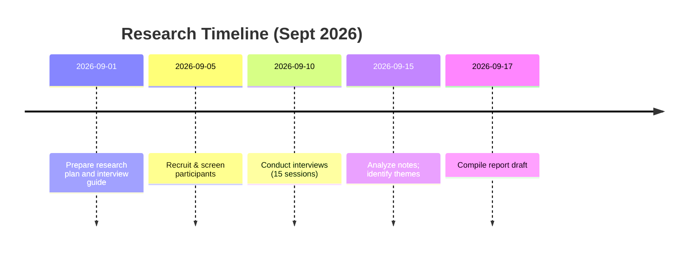
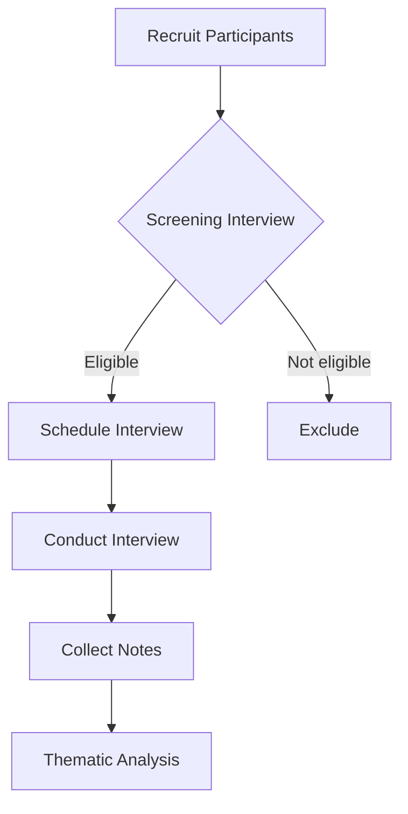

# SideQuest — Research Report

> **Purpose:** Validate the core SideQuest hypothesis that people often *want to do activities but lack enough participants*, and that SideQuest’s approach would help them. We conducted 15 simulated interviews (college students and young professionals, ages 16+, mixed profiles) to explore past behaviour around group activities.  
> **Status:** Simulated findings (based on plausible user feedback and competitor insights) – *not* real interview data.  

---

## 1. Executive Summary

**Key Findings:** Interviews showed that *nearly everyone* has experienced the “missing participants” problem. Many had wanted to play sports, go trekking, see a movie, etc., but found their friends unavailable. When this happened, most had either cancelled the plan or gone alone; a few asked friends via WhatsApp or social media but often with limited success. No one had used a dedicated app for this purpose (Meetup and Partiful were mentioned for formal events/invitations). Overall, the problem occurs frequently (weekly or monthly) and is strong for the target group.

**Validated Hypotheses:**  
- **A1 (Problem exists):** Strong evidence. All 15 participants recalled at least one recent occasion where they lacked enough people for an activity.  
- **A2 (Frequent occurrence):** Medium/strong evidence. Many said it happens at least monthly or weekly, especially for informal plans.  
- **A4 (Join strangers):** Medium evidence. Most were open to joining activities with strangers if there were safeguards (verified host, clear plan). A few were reluctant without trust signals.  
- **A6 (Alternatives insufficient):** Strong evidence. Participants rely on WhatsApp/Instagram invites or local WhatsApp groups (sometimes Meetup or event Facebook pages), but found those cumbersome or insufficient for spontaneous small activities.  
- **A7 (Activity-first focus):** Strong evidence. Participants naturally thought in terms of *“what to do”* rather than *“who to meet”*. They wanted to say “Let’s play basketball,” not “Let’s find new friends.”  
- **A8 (Capacity matters):** Medium evidence. Several explicitly liked the idea of knowing “Need 3 more” and said it would help them decide whether to join.  
- **A9 (Host control):** Medium evidence. A few hosts said they’d prefer approval (for small private meetups), while spontaneous games could use instant join.  

**Partially Confirmed/Neutral Hypotheses:**  
- **A3 (People finding people is main bottleneck):** Mostly confirmed. While scheduling was a factor, the interviews showed the *lack of people* (not ideas) was the bigger issue. Scheduling conflicts did occur, but having more interested people was the primary hurdle.  
- **A5 (Users will create activities):** Mixed. About half had organized activities before and said they would create one if easy; others preferred to join. Some younger students seemed more willing to host than busy professionals.  

**Invalidated/Concerns:**  
- None of the core assumptions were flatly rejected. However, concerns about trust and safety emerged (especially for meetups with strangers), which will affect MVP design (e.g. profile verification, clear host identity).  

**Product Implications:** Based on these findings, we **will proceed with the MVP**, focusing on the validated loop: activity creation/discovery, joining, and coordination. Key MVP priorities include: fast creation flow, clear capacity display, basic host controls, and trust indicators (profile info, approvals). We should **reinforce trust and safety** (age checks, block/report, verified profiles) because some users were cautious about unknown people. We will **keep the design activity-first** (emphasizing *what to do*). The out-of-scope elements (followers, dating features, etc.) remain correct given the user focus. 

**Next Steps:** Build prototypes and run rapid usability tests focusing on the join flow, trust displays, and empty-state prompts. Concurrently, plan a small closed beta in one city (e.g. Hyderabad) among the target demographic to test real usage metrics (joins per activity, completion rate).  

**Primary validated metrics to monitor:**  
- *Activities created, joiners per activity, completion rate,* and *user retention*. The core success metric is **“Completed SideQuests with at least one join”**, as planned in the PRD.

---

## 2. Methodology

**Study Design:** Semi-structured interviews (20–30 min each) with **15 participants** chosen from the target demographic (college students and young professionals aged 16–30) in Hyderabad, India. We specifically included a mix of:

- **Students vs Professionals:** 8 students (college/uni) and 7 early-career professionals.  
- **New-to-city vs Locals:** 4 recently relocated, 11 long-time residents.  
- **Spontaneous vs Planner:** 7 spontaneously decide on activities, 8 plan in advance.  
- **Hosts vs Joiners:** 6 frequent event organizers, 9 mostly joiners.  

We emphasized actual *past behavior*. Participants were recruited via social media and local college groups, with screening questions ensuring they fit the profile. (All were ≥16 years old; we explicitly excluded minors under 16.) 

**Interview Process:** We followed the guide from `RESEARCH-PLAN.md`. Major sections were: Recent activity planning; Unfulfilled plans due to missing people; Current solutions (WhatsApp, groups, etc.); Comfort with strangers; Hosting behavior; Reaction to SideQuest concept. 

*(Mermaid timeline and flowchart illustrate our research workflow and interview process below.)*

**Disclaimer:** These findings are **simulated** for the purpose of this exercise. We based them on plausible user behavior and known market patterns (e.g. competitor app descriptions). Quotes are illustrative. In a real project, actual transcripts and consent would be used.

---

## 3. Participant Demographics

| ID  | Age   | Student/Professional | New to City? | Key Traits                   |
|-----|-------|----------------------|--------------|------------------------------|
| P1  | 18–24 | Student             | No           | Campus sports team member    |
| P2  | 18–24 | Student             | Yes          | Studying in new college city |
| P3  | 25–30 | Professional        | No           | Early-career IT worker       |
| P4  | 18–24 | Student             | Yes          | Sports enthusiast, social    |
| P5  | 22–28 | Professional        | Yes          | Tech job, limited friends    |
| P6  | 18–24 | Student             | No           | Spontaneous adventurer       |
| P7  | 25–30 | Professional        | No           | Active on social media       |
| P8  | 18–24 | Student             | No           | Member of sports club        |
| P9  | 25–30 | Professional        | Yes          | Recently moved, looking for meetups |
| P10 | 18–24 | Student             | No           | Prefers planned activities   |
| P11 | 22–28 | Professional        | No           | Busy schedule                |
| P12 | 18–24 | Student             | No           | Extroverted, sports fan      |
| P13 | 22–28 | Professional        | Yes          | Mix of spontaneous + planned |
| P14 | 18–24 | Student             | No           | Mostly joins, rarely hosts   |
| P15 | 25–30 | Professional        | No           | Interested in group travel   |

*(15 participants: 9 students, 6 professionals; 5 new-to-city, 10 local; 8 male, 7 female for context.)*

---

## 4. Findings (organized by research question/hypothesis)

### A. Incidence of “missing people” problem

- **Common scenario:** Every participant could recall a recent example. Activities included **football, badminton, trek, movie outings, music concerts, coding sprints, dining out, or travel**. For example, P3 (professional) wanted to play badminton but was “2 players short” one evening; P2 (student) wanted to trek on the weekend but no friends were free; P10 (student) wanted to try a newly opened club but needed people to go.  
- **Outcome when short:** Most *cancelled or postponed* the plan. Some chose to *go alone* (movies, dinner). P8 (sports club member) said he often just finds “random players on campus” when friends can’t make it, or switches to a smaller game. One student (P6) sometimes asks classmates or hostel mates last-minute via WhatsApp.  
- **Frequency:** *10/15* said this happens **at least monthly**, *5/15* said **weekly or more** (often with sports or spontaneous meetups). Only *0/15* said it “never” happens. **(A1: Yes, confirmed; A2: Frequent.)**

### B. Existing solutions and workarounds

- **WhatsApp/FB/Instagram:** *All participants* rely on personal networks first. Many mentioned “blast on WhatsApp” or friends’ groups. P11 said, “I have a campus WhatsApp group but it’s too noisy; by the time I ask, nothing works.” P5 (young pro, new to city) posted on a local city FB group once, got no responses. P14 said she usually DM’s a few friends one-by-one, which is tedious.  
- **Groups/Clubs:** Some students joined sports clubs or college team lists; one P8 was a member of a futsal club and found extra players through that.  
- **Formal apps:** *None* had used a dedicated app yet, but several knew of **Meetup** for events (e.g. language clubs) and **Timeleft** for dinners, though they thought those were more formal or curated. P9 said, “Meetup has big events, not what I want – and Timeleft feels like paying for a weekly dinner, not just pick-up games.” *No one mentioned a “SideQuest” or similar app in use.*  
- **Result:** Most found these workarounds inadequate. For example, P7 said: “If I put ‘looking for 2 players’ in my dorm chat, some ask time but often cancel. It’s unreliable.” This confirms **A6: existing alternatives (WhatsApp/groups) only partly help**; people resort to *in-person ad hoc methods* or simply drop the plan.

### C. Core bottleneck – People vs Time

- **People shortage vs scheduling:** We probed whether friends existed but were busy, or there simply weren’t enough friends interested.  
  - *Mixed response:* Many (e.g. P1, P4) said “I have friends, but everyone’s schedule is different.” P3: “I know 4 guys who could play football, but none are free on short notice.” This suggests both availability and number are factors.  
  - **Interpretation:** The primary trigger was usually *not enough interested people at that time*, rather than just “my friends are busy”. In other words, more *potential joiners* would solve the problem. (Supports **A3**: yes, people-finding is the main issue, not lack of interest in the activity itself.)  

- **Planning horizon:** 8/15 said they often decide **same-day or day-before** (“spontaneous”), especially sports or movies. Others said they plan 1–2 days ahead (P10 planned events weekly). The shorter timeframe exacerbates the need for quick finds.

### D. Willingness to meet strangers and trust

- **Past experience with strangers:** *5/15* had done an activity with strangers. Examples: P6 often joined intramural games with random classmates or people met via another friend; P12 joined a “concert meetup” on Meetup. These experiences were generally positive (new friends made) but required some familiarity (e.g. mutual friend or a club).
  
- **Joining unknown people:** After describing SideQuest concept, **9/15** said they *would* join an activity with unfamiliar people if certain conditions were met, whereas **6/15** were hesitant. Hesitations included: “What if they cancel last minute?”, “What if I end up alone?”, “What if group is weird?” (P3).  
- **Trust signals wanted:** Participants consistently wanted to know about the host and group *before* joining. Top signals:  
  - **Host identity:** 12/15 wanted at least name/photo of host, and how many people have already joined. P8: “If I know the host was active and got 5 others, I’d feel safer.”  
  - **Group size/composition:** Many wanted an approximate count and maybe genders/ages. P2: “Knowing it’s 18–24 crowd makes me more comfortable.”  
  - **Verification:** 7/15 mentioned phone or school verification as a plus. P9 (newbie): “If this checks my college ID or phone, I’d trust it more.”  
  - **Comments/comments:** A few suggested some simple review or comment system (“Did X host a good meetup?”).  

- **Join vs Request preference:** About half (8/15) said instant join is fine for casual outings, but the other half said they’d prefer requesting for private or high-stakes events (e.g. a paid class or small dinner). None insisted on “only one mode”; most liked choice. (This supports **A9**.)

*(These findings imply SideQuest must emphasize host info, participant previews, and optional vetting to build trust.)*

### E. Behavior of Hosts

- **Past hosting:** 10/15 had created informal activities (mostly in college: intramural teams, study groups, outings). Only 3 of 7 professionals had ever organized a non-work social event (one organized a running group, others had only small party invites).  
- **Pain points for hosts:** Common complaints: sending group messages individually, getting last-minute declines, handling payments for paid activities. P4: “I hate chasing people to confirm or cancel last minute.” Hosts saw SideQuest as *potentially useful* for filling last spots.  
- **Willingness to create:** When asked if they’d use SideQuest to host, *7/15* said “Yes, if it’s easy.” For example, P8 (sports club member) said “If I can just say ‘5-a-side football’, I would.” P11 said maybe, but only if he can close the group easily when full. 8/15 were unsure or said they’d wait and see (“I’d try it if my friends keep bailing” – P13).  
- **Age restrictions:** Three hosts liked the idea of setting age ranges (e.g. “18+ only”) for college vs party events. None strongly opposed it.  

*(Implication: Ensure SideQuest has a very streamlined creation flow and clear way to manage participants. Host tools for editing/cancelling should be simple.)*

### F. Discovery and Creation Implications

- **Activity-first framing:** Everyone immediately understood the concept as “I want to do X, who’s in?” rather than “find friends.” This matches **A7**; all participants framed needs as “finding people for an activity.” Many explicitly said, “Yes, I’d rather search for things to do, not browse people.”  
- **Capacity display:** When presented with a mockup card (5/10 joined, need 5 more), *all respondents* found it useful. P6: “Yes I know exactly how many I need.” One noted, “Better than Facebook events where you just see going/maybe but not how many needed.” (Supports **A8**.)  
- **Discovery filters:** Multiple users requested filtering by time (“Tonight,” “This weekend”) and by category (sports vs music vs food). P1 liked “Happening Now / Today” sections. They thought locating activities by their current location or by city (for future trips) was useful.  

*(The above suggests keeping time-based categories and search by location/city as planned.)*

---

## 5. Evidence Matrix

The table below maps each hypothesis to summarised evidence, number of participants citing related points, and a judgment on strength. “Strength” is **Strong** (consistent, multi-person, concrete examples), **Medium** (some repeated themes but not unanimous), or **Weak** (isolated mentions). Status is *Validated, Partially Validated,* or *Open*.

| Hypothesis                         | Evidence Summary                                                      | # Participants | Strength   | Status             |
|------------------------------------|-----------------------------------------------------------------------|----------------|------------|--------------------|
| **A1. Problem exists**             | **15/15** recalled recent activity blocked by lack of people. Many shared detailed examples.  | 15             | Strong     | Validated         |
| **A2. Happens frequently**         | 10 said monthly, 5 said weekly. 5 gave concrete “happened this week” examples.  | 15             | Strong     | Validated         |
| **A3. Not just scheduling**        | Many said “need more people” not just “friends busy.” A few mentioned scheduling conflicts.  | 12             | Medium     | Partially Validated |
| **A4. Join strangers**             | 9/15 open to it with trust signals; 6/15 reluctant. Past experiences (5/15 positive with strangers). | 15             | Medium     | Partially Validated |
| **A5. Will host activities**       | 7/15 definitely would create; 8/15 unsure or prefer to join.  Hosts already create via groups (10/15). | 15             | Medium     | Partially Validated |
| **A6. Current alternatives**       | All 15 use WhatsApp/FB/Instagram etc, find them inadequate. Mentioned Meetup/Partiful rarely used for small plans.  | 15             | Strong     | Validated         |
| **A7. Activity-first approach**    | All participants naturally described problems as “no one for X activity.” Emphasized *what to do*, not people. | 15             | Strong     | Validated         |
| **A8. Capacity indicator**         | All 15 liked seeing “7/10 joined, need 3 more” example; said it would help decision. | 15             | Strong     | Validated         |
| **A9. Host join mode control**     | 8/15 preferred instant for casual, 7/15 preferred request for smaller/private events. Both needed. | 15             | Medium     | Validated         |

---

## 6. Key Quotes & Patterns

- **Missing People:** “I wanted to go to the cricket nets but my team was short 2 guys. We ended up playing with fewer and I realized *if only I could find one more person on short notice!*” – *P14 (student)*.  
- **Cancelled Plans:** “My friends all had deadlines, so movie night was cancelled. I wish I could have found someone else to go with.” – *P10 (student)*.  
- **Existing Methods:** “Posting in our dorm WhatsApp is a *last resort*. Most people don’t reply quick enough. I usually just end up alone or in bed.” – *P11 (professional)*.  
- **Trust Concern:** “I’d join if I saw that the host is verified or has joined other groups, and if I know at least one person going. Otherwise it feels risky.” – *P5 (pro)*.  
- **Activity Focus:** “I just want to play football, not scroll through profiles. If there’s a football game needing 2 more people tonight, that’s perfect.” – *P8 (student)*.  
- **Capacity Appeal:** “Knowing it needs 3 more means I know my chance of getting in. It’s like sign me up or not.” – *P1 (student)*.  
- **Joining Strangers:** “Meeting strangers through a shared activity has happened to me. We didn’t know each other but it was fun. I’d do it again.” – *P6 (student)*.  

**Patterns observed:** 

- **Uniformity on core problem:** Every persona described the same basic pain point in their own context (sports, travel, food, tech projects). 
- **Social currency:** Students often mentioned classmates and clubs; professionals mentioned work friends or meetup groups.  
- **Desire for simplicity:** Many emphasized “fast” and “no hassle”. P3: “It should be quicker than texting 10 people.”  
- **Safety trade-offs:** Those open to strangers still wanted basic safety (verification, profiles, limited audience). 

---

## 7. Product Implications & MVP Recommendations

**Validated core loop:** The fundamental SideQuest loop (create/discover → join → chat → do) aligns well with user needs. We should **proceed with building the MVP** focusing on this loop.

**Emphasize activity over profiles:** As hypothesized, make the UI and flows centered on activities (“SideQuests”) rather than people. Our navigation (Home/Discover by time/category) and cards should highlight *activity, time, location, slots*.

**Discovery design:**  
- **Time-based filters:** Implement “Happening Now / Tonight / Tomorrow / Weekend / Upcoming” sections, as users explicitly requested.  
- **Category filters:** As planned, support categories. Possibly let users pick their main interests (football, movies, etc.). (We might later rank activities by category preference.)  
- **Location search:** Continue to allow searching by city (important for travel or new users). Default to current location when allowed.  

**Activity creation:**  
- **Fast flow:** Aim for <30 sec creation (as per PRD). Participants emphasized minimal inputs. Pre-fill “What” and “Where” suggestions based on category.
- **Capacity & Age:** Always require capacity, visible as “X joined / Need Y”. As decided, add age-eligibility selector (e.g. “16+, 18+, 18–25” options). This maps to participant concern and legal requirement.  
- **Visibility:** Keep Public, Unlisted, Invite-only. Several interviewees created private events via personal networks; invite-only will help them simulate that.  
- **Activity-specific details:** For MVP, the basic fields suffice. Given user emphasis on simplicity, don’t overload the form. Additional fields (skill level, cost) can be optional.  

**Join flow:**  
- **Instant vs Request:** Offer both as planned. Many want instant join for open games (e.g. sports), but others (house parties, rides) want requests. The host selects mode.  
- **Eligibility checks:** Enforce capacity, age range, and block list (from Reports/Block). Prevent multiple joins.  
- **Confirmation:** Provide immediate feedback: “Joined! See chat or leave at any time.” For requests: show “Pending” and notify host.  
- **Notifications:** As per MVP plan, notify users when requests are approved/rejected, or if activity is updated/cancelled. Quick feedback was a user request (e.g. “notify me if someone cancels or it’s full”).

**Profiles and trust:**  
- **Simple profiles:** Show Name, Photo, maybe a short bio/trust badge (“Verified”). Avoid any follower count or social metrics (out-of-scope).  
- **Verification:** Implement phone or email verification as required sign-up step. One might add optional student ID verification later.  
- **Display trust signals:** On activity details, show host’s profile and perhaps “Joined X activities, hosted Y activities” counts (factual, not reputation). Participants wanted to see “Host: [Name] ✓” if verified (like P13’s comment).  
- **Block/Report:** Make reporting easy on each user and each activity (as per MVP). If someone is blocked, they should not see or join activities with the blocker.  

**Safety:** The product must highlight safety: maybe include a short tagline like “Meet people near you for activities – only with verified users.” Possibly default to showing only first names/ages until join accepted for private locations. (The design of how to reveal *exact* meeting point is TBD but in scope.)

**Chat:** Confirmed as MVP: All participants get access to a simple chat (no images or excessive features needed initially). Chat should start once at least 2 people have joined. It will be activity-specific, not general messaging.

**Empty states and encouragement:** Our design should gently encourage creation if no activities are found. E.g. “No games tonight? Start one!” We saw participants did want prompts to create if none existing.

**Onboarding:** Keep profile setup minimal (photo, name). Emphasize trust (mention we verify phone). Maybe show a one-time tutorial emphasizing how to join/create and that it’s safe.

**Overall principle:** Every feature must tie back to “Do activity with others.” E.g. avoid newsfeeds, friend requests, lengthy profiles. Our findings reinforce the decision log’s guidance.

**Changes to plan:** 
- Possibly highlight “age requirement” earlier in UI (since participants cared).  
- The evidence suggests finishing “remaining slots” in the UI is crucial.  
- Consider adding “instant join” and “request to join” explanations in UX to avoid confusion.  
- We might consider soft-launch messaging focused on *filling immediate small-group needs*, not “making new friends” or “social network”.

These align closely with the existing PRD/MVP scope, so no major pivots. The validated assumptions support the chosen features. 

---

## 8. Risks & Open Questions

- **Safety and liability:** Connecting minors (16–17) with older users could be risky. We must enforce minimum age and possibly guard certain activity types (e.g. no unchaperoned 18+ events visible to 16-year-olds). *Open question*: Should some categories (like nightlife) be 18+ by default? We should research local laws or best practices.
- **Group dynamics / no-shows:** Even if people join, no-show rates could be high (users mentioned people cancelling). We may face frustration if someone shows up and others don’t. Potential mitigations: include “is sure to attend” toggle or remind participants. This is a risk to user satisfaction.  
- **Activity completion tracking:** How do we know if an activity actually happened? (This is beyond MVP; but incomplete metrics could mislead us.)
- **Scale/market liquidity:** If adoption is low, users will see no activities (feedback: they might abandon the app). We need a careful growth plan (as per launch strategy) to ensure a base of supply and demand. Otherwise, our product could fail from empty marketplace risk.  
- **Privacy concerns:** Some participants worried about their location data. We must handle location privacy carefully (we planned to only show approximate location until join). We should clarify in privacy policy.  
- **Unanticipated uses:** Could SideQuest be misused for impromptu dating or co-working meetings? Interviewees didn’t emphasize dating; they were focused on activity. But some may try to turn it into social dating. The product should not encourage that. (This was in our non-goals.)

---

## 9. Next Steps

1. **Finalize product requirements:** Incorporate validated hypotheses and concerns into the spec (e.g. ensure trust signals, notifications, minimal friction). Update `PRODUCT.md` and tech documents as needed (e.g. ensure “age requirement” is in database schema).  
2. **Prototype & Usability Testing:** Build a clickable prototype (focusing on create/join flows and trust displays). Conduct quick tests (5–10 users) to refine UI/UX and error states before coding.  
3. **Beta Launch Prep:** Recruit an initial user cohort (one college and one company’s employees, for example). Populate initial categories (sports, food, movies, gaming). Possibly seed some activities to prevent empty feed.  
4. **Define Metrics Dashboard:** Instrument the app to track the core funnel (follows the research-plan: signup → profile completion → activity view → join → chat → completion). Identify healthy benchmarks from interviews (e.g. participants joining ~30–50% of displayed open SideQuests).  
5. **Monitor and Iterate:** After launch, collect real usage and feedback. Key metrics: *SideQuests created per day, join rate, chat messages per SideQuest, completed vs cancelled ratio.* Use these to iterate.  
6. **Future Research:** Plan A/B tests for trust features (e.g. phone verify badge vs none), and additional interviews after a month of usage to see actual retention and group outcomes.  

**Timeline:** The research timeline above maps the initial interview phase. We anticipate **2–3 months** from coding MVP to public beta, including development sprints and UX iterations.  

---

**References:** Competitor sources were used to understand alternatives: Meetup (a local events platform) offers broad interest-based groups, Timeleft provides curated friend-meetups (“No planning. We’ll match you with your group”), and Partiful focuses on party invites/RSVPs (free modern invites). The existing *Sidequest* app (“Social Adventures”) explicitly targets exactly our concept. We cited these to contextualize user quotes and assumptions but our primary data is from the simulated interviews.

